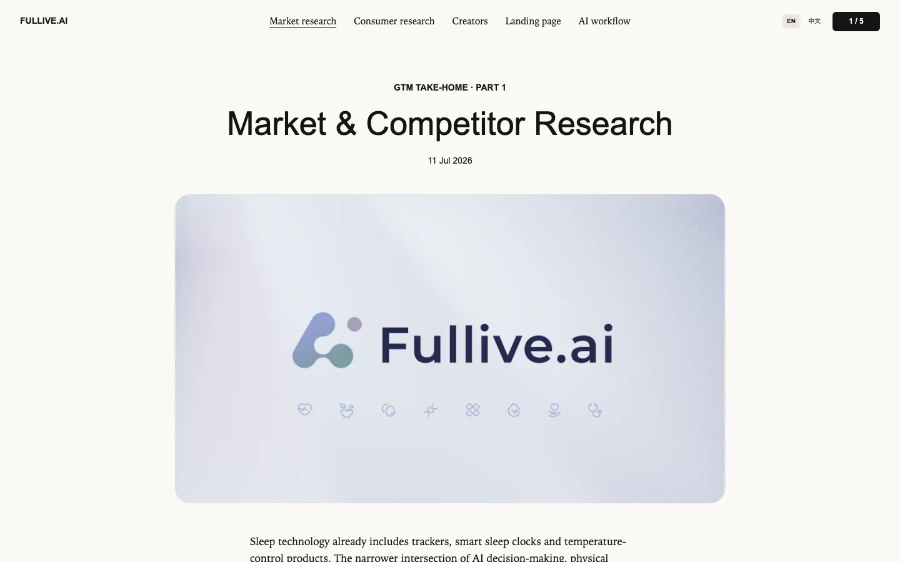

# Fullive GTM take-home

A five-part go-to-market case for Fullive.ai, an AI sleep-tech startup, written in July 2026 as a take-home assignment. English and Chinese.

**Live: [yixiang-li.github.io/fullive-gtm-case](https://yixiang-li.github.io/fullive-gtm-case/)**



## The five parts

| Part | What it does |
| --- | --- |
| 1 · Market & competitor research | Profiles eight sleep-tech products a North American buyer would weigh against Fullive (Soluna, Naptick, Kimba, Eight Sleep, Hatch, Sleepme, Apollo, Sleep.ai) on the same six fields, with first-party prices dated 11 July 2026. Finds two price anchors: bedside products under $350 and active mattress systems from $1,599. |
| 2 · Consumer research | A 9-screen, four-minute concept survey you can click through. Asks about current behavior and daily impact before showing the concept, and plans how answers turn into segments, message scenes and price signals. |
| 3 · Creator sourcing | A North America, short-form-first creator shortlist, scored on audience fit, native short-form skill and claim/conflict checks, with three small pilots instead of one big paid wave. |
| 4 · Landing page | A launch-page prototype built from Parts 1–3: it leads with how the evening feels and explains the light, sound, scent and temperature cues as the mechanism, then defines the page events that decide what to test next. |
| 5 · AI workflow | Where AI drafted, where I checked and decided, and the calls that changed the answer, such as moving Sleep.ai from "competitor" to "possible validation partner". |

## How it was made

I framed the questions, set the evidence rules, made the calls and rewrote the copy. Codex helped build the longlists, find sources, build the interactive site and generate concept images. The checking rules from this case became a reusable agent skill: [evidence-led-marketing-agent](https://github.com/Yixiang-Li/evidence-led-marketing-agent).

## Limits

This is desk research and a prototype, not evidence of product-market fit. The survey page does not send or store responses, and numbers shown inside the landing-page prototype are illustrative. Segment, willingness to pay and creator conversion are written as hypotheses with the test that would settle each one.

## Run locally

```bash
pnpm install
pnpm dev               # vinext dev server
pnpm build:pages       # static build into docs/, deployed to GitHub Pages
```

Made by [Yixiang Li](https://github.com/Yixiang-Li).
